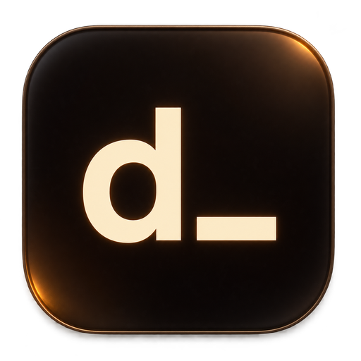
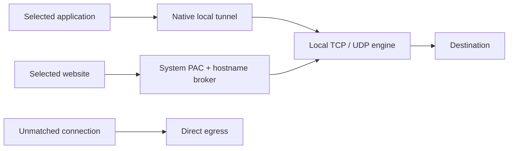

<div align="center">



# Driftnet

**Selected apps. Selected sites. One switch.**

A menu bar and tray app for local, selective access.
A quiet amber interface, your own rules, and no remote VPN account.

[Install](#install) · [How it works](#how-it-works) · [Updates](#updates) · [Build](#build-from-source) · [Contribute](CONTRIBUTING.md)

</div>

## What it does

- Turn **Access** on or off from a single switch.
- Add websites and applications in Settings, with website favicons and available app icons.
- Route selected applications' TCP and UDP connections through a local engine, including apps that do not support proxy settings.
- Use the optional Discord preset for its application, website, downloads, and media. Discord does not need to be installed to use Driftnet.
- Keep unmatched connections on direct egress and exclude local network and loopback destinations from the tunnel.
- Keep rules on your device and restore the previous website proxy settings when the session ends.
- Check for signed updates and install the complete app and networking helper together.

Driftnet connects to the actual destination. It does not provide a remote VPN server,
change your public IP address, or require a subscription. Results depend on the
protocol, destination, and network restrictions; no app can promise that every
website or connection will work on every network.

## Install

Use a package attached to [Releases](https://github.com/ernilmz/driftnet/releases).
This repository is currently **private**; downloading releases requires repository
access. Only install a package for your system and architecture.

| Platform | Package | Scope |
| --- | --- | --- |
| macOS 13+ | Combined `.pkg` | App and LaunchDaemon helper in one installer. Apple Silicon is the locally built target. This backend does not require Apple Developer membership. |
| Windows 10/11 x64 | `Setup.exe` | App, routing service, Wintun, and WebView2 handling in one installer. |
| Ubuntu 24.04+ | `.deb` | Native app, engine, and systemd helper. GNOME is the supported desktop for website rules. |

Install once, approve the operating system's normal administrator request, and
open Driftnet. Click **d_** in the macOS menu bar, or the Driftnet tray icon on
Windows/Linux, and turn **Access** on. No ports, proxy addresses, browser extensions,
or separate engine programs need to be configured.

On Linux, use the desktop package installer. A GNOME tray indicator extension may
be needed to display tray apps. Native application selection accepts an installed
`.desktop` launcher or native ELF executable. Flatpak, Snap, AppImage, script-based
launchers, and arbitrary desktop environments are outside the current supported scope.

The packages currently lack production Apple notarization and Windows Authenticode
certificates, so the operating system may ask for additional publisher approval.
Update-payload signatures are implemented separately; they do not replace OS
publisher trust. Keep OS security protections enabled.

### Add your rules

In **Settings → Websites**, add a domain such as `example.com`. Subdomains are
included. If a website uses other domains for sign-in, images, or media, add those
as well. In **Settings → Apps**, choose an application. Application routing is
based on its canonical executable or application bundle, rather than its display name.

The Discord preset appears under both tabs because it covers the app and its web
services. Disable or remove it to use Driftnet only with your own rules. Closing
and reopening a selected app does not require toggling Access.

Turn Access off or choose **Quit Driftnet** to end the session. The macOS and Windows
tray menus include **Uninstall Driftnet…** for removal of the app and helper. On
Linux, remove the `driftnet` package through the package manager. In-place updates
retain the stable application identity and rules stored outside the install directory.

## How it works



The shared Rust policy and Tauri interface control an authenticated local helper.
The helper creates a TUN interface and attributes connections to OS process
identities. Only applications selected for the authenticated desktop user enter
the local engine. Unknown or unmatched identities use direct egress.

The local TUN receives public traffic for classification: direct egress still
involves local processing. LAN and loopback routes are excluded. Protected processes,
unavailable ownership metadata, and unusual helper processes can limit attribution;
Driftnet does not expand a rule to every application or a shared CDN IP to compensate.

Selected websites use an OS automatic proxy configuration (PAC) and a broker that
checks hostnames again. Unmatched hosts return `DIRECT`. Selected public website
names resolve through TLS-validated DNS over HTTPS, with A/AAAA answers and address
failover. System-wide DNS settings remain unchanged. TLS is not decrypted and no
interception certificate is installed.

See [network architecture](docs/ENGINE.md) for ownership checks, cleanup, platform
scope, IPv6 behavior, and protocol limits.

## Updates

Driftnet checks approximately 20 seconds after launch and every six hours while
running. You can also choose **Check for updates** from the tray menu. A verified
update adds a small download action next to Settings. Click it to stop the current
session and open the operating system's installer; normal administrator consent
still applies.

Both the complete update manifest and the downloaded installer require valid
Minisign signatures from the embedded public key. The signed version must match;
platform URLs, installer bytes, and metadata cannot be substituted independently.
Updates use the full `.pkg`, `.exe`, or `.deb`, so the privileged helper is upgraded
together with the app.

The anonymous update feed cannot access private GitHub releases. While the
repository remains private, use its installers manually. Automatic delivery will
become available when the release feed is public; no GitHub token is embedded in
the application. A failed check never changes Access or forces a sign-in.

## Verification status

Version **1.0.0** contains the native routing, Linux integration, reopen correction,
and signed updater. Implementation and observed device acceptance are tracked
separately in [the acceptance record](docs/ACCEPTANCE.md).

The macOS 1.0.0 package is installed: its receipt and running helper report 1.0.0,
and migration left only Driftnet installed. Three normal Discord quit/reopen cycles
reached the main screen during one continuously active Access session. The native
IPv4-only tunnel, selected/direct ownership counters, actual OS proxy selection,
and gateway HTTP 200 were observed. Release engine smoke/socket and public
website-policy probes also passed.

The current version's real Discord voice/video has not been user-tested. The
optimized Windows installer has been cross-built. The Linux policy/engine CI job
passed in [run 42367749112](https://github.com/ernilmz/driftnet/actions/runs/42367749112);
the macOS, Windows and Ubuntu desktop jobs are still running. Native desktop CI
and device acceptance remain separate: a build alone does not establish successful
installation or voice on another platform.

## Build from source

Build on the target OS for normal distribution. Developers need stable Rust,
Node 22+, Python 3, Go 1.27+, and the [Tauri native prerequisites](https://v2.tauri.app/start/prerequisites/).
macOS needs Command Line Tools. Windows needs Microsoft C++ build tools and a C
compiler for the engine. Linux needs WebKitGTK 4.1, GTK 3, Ayatana AppIndicator,
OpenSSL development libraries, a C compiler, and packaging tools. End users do not
need these development tools.

On macOS or Windows, from the repository root:

```sh
python3 scripts/build-sidecars.py --release
cd ui
npm ci
npm run build
cd ../apps/desktop
../../ui/node_modules/.bin/tauri build
```

On Windows, set `DRIFT_ENGINE_CC` to the compiler executable; CI uses MinGW GCC.
`DRIFT_GO` selects a Go executable outside `PATH`. Router targets share a temporary
source directory; use separate checkouts for parallel builds.

After the macOS app bundle has been built:

```sh
python3 scripts/sign-dev-macos.py --app target/release/bundle/macos/Driftnet.app
python3 scripts/build-macos-installer.py --app target/release/bundle/macos/Driftnet.app
```

On Ubuntu, build the desktop without a Tauri installer, then create the combined
native package:

```sh
cd apps/desktop
../../ui/node_modules/.bin/tauri build --no-bundle
cd ../..
python3 scripts/package-linux.py
```

Build scripts verify pinned engine/router source hashes before applying documented
changes to temporary copies. Packaging does not publish anything. Maintainer update
signing and platform publisher signing are described in [CONTRIBUTING.md](CONTRIBUTING.md).

## Development checks

```sh
cargo fmt --all -- --check
cargo test --locked --workspace
cargo clippy --locked --workspace --all-targets -- -D warnings
python3 scripts/test-engine.py
cd ui
npm run format:check
npm run build
```

Desktop checks require native Tauri dependencies. `probe-network.py` is an opt-in
probe against public endpoints; it does not launch apps or change system proxy/DNS
settings. Native routing, installation, real voice, and GUI behavior require
separate evidence.

## Source and licenses

The independent Rust/UI code is [MIT licensed](LICENSE). The separate native
router incorporates GPL-3.0-or-later sing-box code; its corresponding source archive
accompanies installers. The C engine incorporates MIT-licensed ByeDPI 17.3 with
documented build-time changes. Windows includes the official signed Wintun binary
under its supplied binary license. Fonts, icons, and dependencies retain their
respective licenses.

The distributed router source archive was extracted and built offline for macOS
arm64, Windows x64 and Linux x64/arm64 using only its vendored dependencies. These
helper cross-builds are separate from native desktop and device acceptance.

See [third-party notices](THIRD_PARTY_NOTICES.md), [router integration](native/router/README.md),
and the notices packaged with the app. Driftnet is not affiliated with Discord,
SagerNet, WireGuard, or the websites and apps selected by users.
